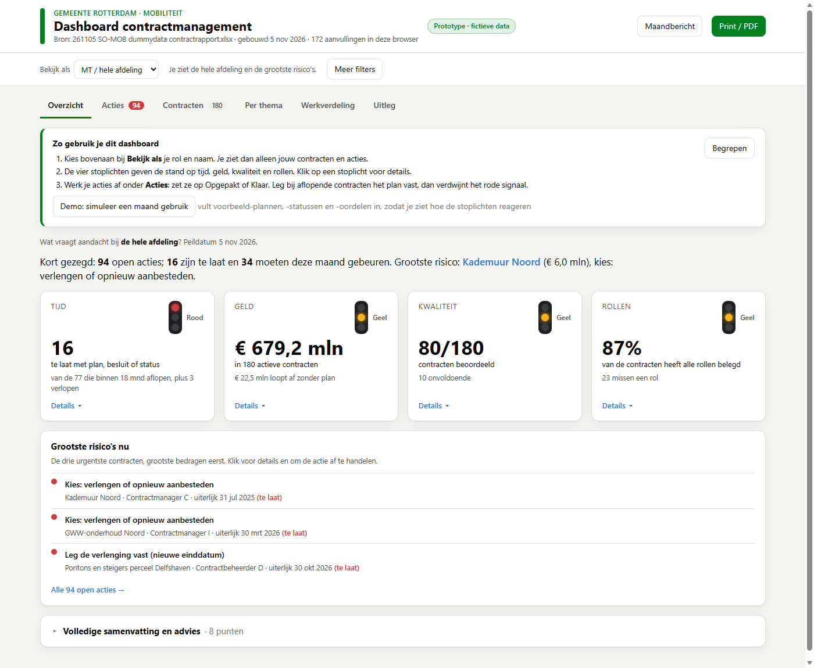

# Contractmanagement: dashboard CM Rotterdam

Team Contractmanagement · Themadag Mobiliteit, 5 november 2026.

**De pitch in één zin:** één scherm dat per rol laat zien welke contracten aandacht vragen, wat er moet gebeuren, wie aan zet is en vóór wanneer.



## Status (demo vanmiddag)

- [ ] Open besluiten in [`DECISIONS.md`](DECISIONS.md) bevestigd (D-001 t/m D-012)
- [x] Script met synthetische data in de 15 kolommen van de contractexport (D-002)
- [x] Bouwscript: export → één `index.html` die opent met een dubbelklik (D-001)
- [x] Eerste laag: vier stoplichten (tijd, geld, kwaliteit, rollen) en een samenvatting van één zin (D-006, D-011)
- [x] Signalen als acties: wat, wie, uiterlijk, met status Open / Opgepakt / Klaar (D-003)
- [x] Afloopsignaal met de doorlooptijd van de aanbesteding, en het verschil met/zonder verlengingsoptie (D-004, D-005)
- [x] Filters per rol ("Bekijk als") en per thema; doorklikken van totaal naar contract
- [x] Rollen en werkverdeling: niet-belegde rollen, vertrek, functiescheiding, capaciteit tegen een instelbare norm (D-008)
- [x] Wettoets als hulpmiddel: Aanbestedingswet art. 2.140 en 2.163, BW boek 6 bij tekortkoming (D-007)
- [x] Maandbericht per persoon of voor het MT, en printbaar
- [x] "Hoe te demonstreren" (3 stappen) en een screenshot

## Brief

Overgenomen uit het ontwerpformulier van het team. Persoonsgegevens en bedragen zijn weggelaten; het origineel staat lokaal in `_private/`.

**Probleem.** De afdeling heeft veel contracten. Het overzicht op tijd, geld, kwaliteit en verantwoordelijkheden ontbreekt soms. Er is veel data (onder andere in Oracle), maar die is niet gebruiksvriendelijk. De rollen zijn belegd, maar het is lastig voor iedereen om zijn rol te pakken.

**Voor wie.** Contracteigenaren (teamleiders, als ambtelijk opdrachtgever), contractmanagers en contractbeheerders. Daarnaast het MT, voor het overzicht van contracten en waarden.

**Wat het team wil.**
- Inzicht in financiën, looptijden, realisatie van afspraken en werkverdeling. Zowel voor alle contracten samen als per contract.
- Contracten koppelen op thema of onderwerp.
- Signalen bij personele wisselingen, personeelstekorten en niet-ingevulde rollen.
- Een maandelijkse update met een signaal als een contract binnen 1,5 jaar afloopt, met onderscheid tussen aflopen mét en zonder verlengingsoptie.
- Wat de tool doet: samenvatten, visualiseren, adviseren en signaleren. Met een koppeling naar de Aanbestedingswet en het Burgerlijk Wetboek, verwijzing naar de bron, en een kritische houding tegenover de eigen invoer.
- Uitkomst: een dashboard met het VRI-model (stoplichten), een leuke voortgangstool, kort en duidelijk. Ook printbaar.
- Vandaag: de omgeving en vormgeving, om te zien of het haalbaar is. Los van echte data.

## Scope vandaag (hek)

**Wel:**
- Een conceptdashboard op synthetische data met dezelfde 15 kolommen als de contractexport (D-002).
- Eén pagina met lagen: eerst de stand en de drie urgentste acties, daarna details per stoplicht, daarna lijsten (D-011).
- Aanvullingen die niet in de export staan (plan bij afloop, kwaliteitsoordeel, status van acties, vertrek), bewaard in de browser (D-010).

**Niet:**
- Echte Oracle-data. Het bouwscript kan een echte export lezen, maar alleen lokaal en nooit in deze repo.
- Uitputting (besteed vs. contractwaarde), KPI-scores, opzegtermijnen en verlengingsopties uit het contractsysteem: die kolommen bestaan nog niet. Het dashboard zegt wat het mist.
- Een juridisch oordeel. De wettoets is een signaal om te laten checken.
- Gedeelde opslag, inloggen en automatisch versturen van het maandbericht.

## Zo draai je het

```bash
cd cases/contractmanagement/prototype
uv run genereer_dummydata.py      # → data/private/<datum> SO-MOB dummydata contractrapport.xlsx (niet in git)
uv run bouw_dashboard.py          # → index.html
```

- Met een eigen export (lokaal!): `uv run bouw_dashboard.py pad/naar/export.xlsx --uit pad/naar/uitvoer.html`. Het script stopt als een van de 15 kolommen ontbreekt.
- Open `index.html` met een dubbelklik. Links om direct te tonen: `#demo`, `#acties`, `#tijd`, `#persoon=cm:Contractmanager A`, `#contract=CM-21-9001`, `#bericht`.

## Hoe te demonstreren

1. Open `index.html`. Het overzicht toont de rauwe export: veel contracten zijn "te laat", omdat de export niet weet of er al een plan is. Klik **Demo: simuleer een maand gebruik**: het rode getal zakt, omdat er nu plannen, statussen en oordelen zijn ingevuld.
2. Klik op het stoplicht **Tijd**. Je ziet aflopende contracten per maand en het vertrekbord. Open een contract. Je ziet wat er moet gebeuren, wie aan zet is en vóór wanneer, plus de tram die de looptijd laat zien. Zet het **plan bij afloop** op "(Her)aanbesteding loopt": het rode signaal verdwijnt.
3. Kies bovenaan **Bekijk als → Contractmanager → Contractmanager A**. Je ziet alleen je eigen acties. Ga naar **Acties** en zet er een op Opgepakt. Open daarna **Werkverdeling**: wie zit boven de norm, en hoeveel contractmanagers zijn er nodig? Sluit af met **Maandbericht**.

## Let op

- **Alles is fictief.** Personen zijn rollen met een letter ("Contractmanager A"). Leveranciers, bedragen en contractnummers zijn verzonnen. De UI zegt "fictieve data".
- **Aanvullingen staan alleen in de browser.** Wat je invult (plan, status, oordeel, vertrek) zie je niet op een andere computer (D-010).
- **Aannames zijn instelbaar.** Doorlooptijden, de Europese drempel, de norm per contractmanager en de grens voor waardestijging staan onder **Meer filters → Normen aanpassen** (D-004, D-007, D-008).
- **De procedure is geschat uit het bedrag.** Werken en diensten hebben verschillende drempels; de export zegt niet welke het is (D-004).

## Parking lot

- Vergelijking met vorige maand: wat is nieuw, wat is opgelost.
- Gedeelde opslag van acties en aanvullingen, bijvoorbeeld een SharePoint-lijst.
- Maandbericht automatisch versturen (bijvoorbeeld met Power Automate).
- AI: verlengingsopties, opzegtermijnen, KPI-afspraken en procedure uit de contract-PDF's halen.
- AI: thema's herkennen uit de omschrijving, voor koppelkansen over clusters heen.
- BW-toets op contractclausules (opzegging, ingebrekestelling) zodra clausules beschikbaar zijn.
- Uitputting en facturen koppelen voor het stoplicht Geld.

## Open vragen voor het team (vanmiddag)

1. Klopt de doorlooptijd van ± 6 maanden voor aanbestedingen onder de Europese drempel? (D-004)
2. Welke norm voor het aantal contracten per contractmanager en per beheerder vinden jullie ideaal? (D-008)
3. Welke kolommen kan Oracle erbij leveren: verlengingsoptie, opzegtermijn, uitputting, KPI-score, procedure?
4. Wie krijgt welk maandbericht, en hoe vaak?
